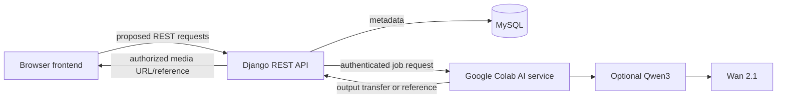

# Architecture

## Component responsibilities

### Frontend

The static browser frontend owns user interaction and presentation: text prompt entry, image upload and preview, supported generation settings, job status display, video playback and download controls, and generation history. It calls the Django REST API and does not communicate directly with model files or the Colab runtime.

### Django backend

Django and Django REST Framework own request validation, application-level authorization, generation job creation and tracking, MySQL access, API responses, references to media, and authenticated communication with the AI service. A long-running generation must not block the request that creates the job.

### MySQL

MySQL stores users (when accounts are implemented), job identifiers, prompts, mode, normalized settings, lifecycle status, timestamps, safe error information, and input/output storage references. It does not store large video files.

### AI service

The separate Google Colab service owns GPU inference. Qwen3 may optionally enhance a prompt, and Wan 2.1 generates the video. The service must expose a protected contract and return a transferable output or an accessible output reference; it must not be assumed to share Django's filesystem.

## Request and response flow

1. The browser submits a proposed text-to-video or image-to-video request to Django.
2. Django authenticates the caller, validates the prompt/image/settings, and records a job in a durable initial state.
3. Django returns a job identifier without waiting for video generation.
4. A backend integration component sends the normalized job request to the protected AI service.
5. The AI service validates its request, optionally processes the prompt, runs the selected Wan 2.1 pipeline, and transfers or exposes the output using the agreed mechanism.
6. Django verifies the service response, records output references and completion metadata, or records a safe failure state.
7. The browser polls or later uses a supported status mechanism to display job progress.
8. Authorized result/history requests return metadata and controlled media URLs.

## Frontend-to-Django communication

The frontend should use JSON for text/settings requests and `multipart/form-data` for image uploads. The API should return stable, documented error shapes. The frontend must treat all endpoint contracts as unavailable until the backend phase implements them.

## Django-to-Colab communication

The integration must use an authenticated server-to-service request over HTTPS where possible. The service contract should include a correlation/job identifier, a normalized generation payload, explicit timeout behavior, and a response that can be verified. Temporary tunnels are development-only and must not be treated as a production security boundary.

## File storage strategy

MySQL stores references and metadata only. During development, `media/inputs/` and `media/outputs/` provide local placeholders and are ignored by Git. Because Colab and Django do not share a filesystem, a later phase must choose one of:

- transfer the input to Colab and transfer the output back;
- use a controlled shared storage location with authenticated access; or
- use another explicitly designed object/file transfer mechanism.

The choice must account for access control, expiry, cleanup, file size, retries, and whether a Colab session remains available.

## Generation job lifecycle

```text
accepted -> queued -> processing -> completed
                         \-> failed
accepted/queued/processing -> cancelled (only if cancellation is later supported)
```

The first implementation should expose only states that can be reliably produced. Every transition should be timestamped and invalid transitions should be rejected or logged. A completed state requires a verified output reference; a failed state requires a user-safe explanation and a diagnostic correlation identifier.

## Architecture diagram



## Deferred decisions

- Exact Wan 2.1 implementation and checkpoint variant.
- Whether Qwen3 improves the project enough to justify its resource cost.
- Queue/worker mechanism for running asynchronous jobs.
- Durable output storage and transfer mechanism.
- Authentication model and deployment topology.

