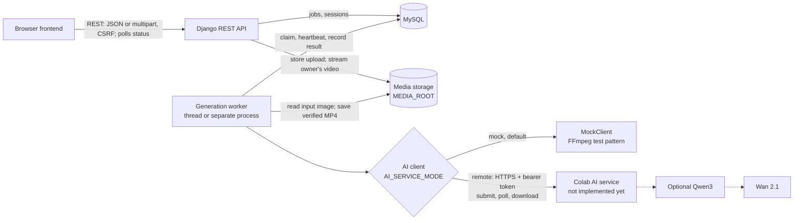

# Architecture

This describes the system as implemented. Where a part is planned but not built (the Colab AI service), it says so.

## Component responsibilities

### Frontend

The static browser frontend (`frontend/`) owns user interaction and presentation: text prompt entry, image upload and preview, supported generation settings, job status display, video playback and download controls, and generation history. It calls the Django REST API under `/api/v1/` and never communicates with model files or the AI service. During development Django serves it; production should use a real web server.

### Django backend

Django and Django REST Framework own request validation, ownership checks, generation job creation and tracking, MySQL access, API responses, and access to media. Requests never wait for a video: the API stores a job and returns `202 Accepted`, and a separate generation worker (below) does the work.

### MySQL

MySQL stores generation jobs (mode, prompt, validated settings, status, timestamps, safe error information, input and output file names, request ID), Django sessions, and Django's standard user and admin tables. It does not store image or video bytes. See [database-design.md](database-design.md).

### Generation worker

`apps.generator.worker` takes queued jobs from MySQL, runs them through an AI client, verifies the output and records the result. It runs as a thread inside `runserver` or as its own process (`manage.py run_generation_worker`). Details are under [Generation worker](#generation-worker-implemented).

### AI service and clients

The worker talks to the AI service only through a client in `ai_service/client/`, selected by `AI_SERVICE_MODE`:

- **`mock` (default):** `MockClient` runs no AI model. It renders an FFmpeg test pattern with the requested size, length and frame rate, and the API labels the result as a mock (`result.is_mock`).
- **`remote`:** `RemoteClient` calls a separate, protected GPU service over HTTP (the contract is below). The intended service runs on Google Colab, where Qwen3 may optionally enhance the prompt and Wan 2.1 generates the video.

**The Colab service does not exist yet.** `ai_service/colab/` exists but is empty, and no model profile has been verified on the T4 (`t4_verified` is `False` for both). The remote client has been tested only against a local fake HTTP service.

## Request and response flow

1. The browser sends a text-to-video request (JSON) or an image-to-video request (multipart) to Django, with a CSRF token.
2. Django checks the request size, CSRF token and rate limit, validates the prompt, image and settings, and enforces one active job per owner.
3. Django stores the job as `queued` (and the uploaded image, if any) and returns `202` with the job ID. Nothing else happens in the request.
4. A worker claims the job (`processing`), builds the request from the stored job, and calls the selected AI client.
5. In remote mode the client submits the job to the AI service, polls its status, and downloads the video, all within one overall deadline. In mock mode FFmpeg renders a test video locally.
6. The worker verifies the MP4, saves it to media storage, and records `completed`; on any failure it records `failed` with a stable code and a user-safe message.
7. The browser polls the job every 3 seconds until it is `completed` or `failed`.
8. The owner plays or downloads the video through `GET /api/v1/generations/{id}/video/`, which checks ownership and supports byte ranges. Media files are never served by URL directly.

## Frontend-to-Django communication

JSON for text requests and `multipart/form-data` for image uploads, with stable, documented error shapes. The implemented contract is in [api-documentation.md](api-documentation.md).

## Worker-to-AI-service communication

Implemented on the client side in `ai_service/client/remote.py`; the service side is not built. Every request sends `Authorization: Bearer <AI_SERVICE_API_KEY>`:

| Request | Purpose |
|---|---|
| `POST /v1/jobs` | Multipart: a `request` JSON part (job ID, mode, prompt, Wan task, size, frames, fps, seed, prompt enhancement, sample options) and, for image-to-video, the `image`. Returns `202 {"job_id": ...}`. |
| `GET /v1/jobs/{id}` | Status: `queued`, `processing`, `completed` or `failed`, with an error object when failed. |
| `GET /v1/jobs/{id}/video` | The MP4 bytes. |

The client:
- never holds one HTTP request open for the whole generation;
- validates the service's job ID before using it in a URL;
- caps each request at `AI_SERVICE_TIMEOUT` and the whole generation at `AI_SERVICE_MAX_WAIT`;
- caps the download at `AI_SERVICE_MAX_VIDEO_BYTES`;
- retries a failed status check up to twice when the error is transient, but never resubmits a job;
- keeps the API key and raw service errors out of user messages.

Use HTTPS for the service URL. A temporary tunnel is for development only and is not a security boundary.

## File storage strategy

MySQL stores file names only; files live under `MEDIA_ROOT` (`media/` by default, ignored by Git):

- `inputs/YYYY/MM/<prompt keyword>-<uuid>.<ext>`: uploaded images, after validation.
- `outputs/YYYY/MM/<job id>.mp4`: verified videos (storage adds a suffix if that name is already taken). The worker writes into a temporary folder outside `MEDIA_ROOT` first and only saves the file after it is verified.

New files never overwrite existing ones. A write that fails part-way is deleted. A stored reference is used only if it resolves to a regular file inside `MEDIA_ROOT` (`apps/generator/media_files.py`, see [security.md](security.md#output-access-controls)).

Colab and Django do not share a filesystem, so the remote client uploads the input image with the submission and downloads the video back.

Retention (development and final-year demo): media is kept indefinitely and never deleted automatically. `find_orphaned_media` is a read-only report for manual review. See [database-design.md](database-design.md#retention).

## Generation job lifecycle

```text
                 claimed by a worker            verified output recorded
  [created] --> queued ----------------> processing ----------------> completed
                  |                          |
                  | queue timeout,           | AI or worker error, deadline,
                  | cancelled by owner       | invalid output, stale lease
                  v                          v
                failed <---------------------+
```

The implemented states are `queued`, `processing`, `completed` and `failed`; `completed` and `failed` are final. There is no `accepted` or `cancelled` status: a cancelled job is `failed` with code `cancelled`, and an expired one is `failed` with `queue_timeout`. Every transition sets its timestamp (`started_at`, `completed_at`); a `completed` job always has a verified output, and a `failed` job always has an error code, a user-safe message and the creating request's ID.

### Generation worker (implemented)

Jobs are processed by `apps.generator.worker`:

- **Running it.** `python manage.py runserver` starts one worker thread inside the development server (`RUN_WORKER_IN_PROCESS=True`, the default). A separate worker can be run with `python manage.py run_generation_worker [--poll-seconds N]` and stopped with Ctrl+C. Both may run at the same time, and several workers may run against the same MySQL database. Each worker processes one job at a time.
- **Claiming.** A worker claims the oldest `queued` job with `SELECT ... FOR UPDATE SKIP LOCKED`, so two workers never claim the same job.
- **Preparation.** Before calling the AI client, the worker re-checks the stored settings against the model profile and, for image jobs, that the input reference resolves to a regular file inside `MEDIA_ROOT`. A job that fails this check is failed at once (`unsupported_setting`, `invalid_job_settings` or `input_missing`), and the AI client is never called.
- **State changes.** Every status change starts from the status stored at that moment, never from a copy loaded earlier:
  - The worker's claim, its result write, stale-job recovery, queue expiry and cancellation each use one conditional `UPDATE ... WHERE status = <expected>`.
  - `GenerationJob.transition_to()` does the same. It raises `StaleJobState` (refreshing the instance) if the stored job has moved on or was deleted, or `InvalidJobTransition` for a change the lifecycle forbids; both are `ValueError`s.
  - `GenerationJob.save()` of an existing row that writes `status` first locks the row (`SELECT ... FOR UPDATE`). It refuses to write if the stored status is not the one the instance last read, if the row is gone (Django would otherwise insert it again), or if the change is not allowed.

  So a stale model instance cannot revive a cancelled, recovered, expired, completed or failed job.

  **What these guards do not cover:** saves that do not write `status` (`update_fields` without it), and any write that bypasses the model's `save()` and `transition_to()`: `QuerySet.update()`, `bulk_update()` and raw SQL. The application's own `QuerySet.update()` calls listed above are written as conditional updates. Any new code that changes `status` must do the same or go through `transition_to()`.

  There is no database constraint. MySQL `CHECK` constraints cannot express transitions (that would need triggers), and a `CHECK` on the allowed status values would need a migration.
- **Leases and heartbeats.** While a job is `processing`, the worker refreshes the job's `updated_at` every `WORKER_HEARTBEAT_SECONDS` (30 s) from a heartbeat thread. A `processing` job whose `updated_at` is older than `WORKER_STALE_AFTER_SECONDS` (300 s) is treated as abandoned (its worker crashed, was killed, or lost power).
- **Recovery.** Every worker fails abandoned jobs (code `worker_interrupted`) when it starts and then every `WORKER_RECOVERY_INTERVAL_SECONDS` (60 s), using one conditional `UPDATE`. A job with a fresh heartbeat, such as another worker's active job, is never touched, and concurrent recoveries fail each job only once.
- **Queue timeout.** In the same cycle, jobs still `queued` `GENERATION_QUEUE_TIMEOUT_SECONDS` (default 30 minutes) after creation are failed with code `queue_timeout`, also by one conditional `UPDATE` (`WHERE status = 'queued'`), so a job being claimed is skipped and never expired after it starts. Claiming ignores jobs past the timeout. `manage.py expire_stale_jobs` runs the same cycle without a worker (`--dry-run` only counts). Without a running worker or that command, nothing expires.
- **Cancellation.** An owner can cancel their own `queued` job with `POST /api/v1/generations/{id}/cancel/`; it becomes `failed` with code `cancelled`. A claim and a cancellation race on the same row lock, so exactly one of them takes effect. `processing`, `completed` and other `failed` jobs cannot be cancelled (`409 not_cancellable`); cancelling an already-cancelled job changes nothing and returns `200`. Cancellation deletes no files.
- **One active job per owner.** The API refuses a new generation request (`409 generation_in_progress`) while the owner (signed-in user or guest session) has a `queued` or `processing` job. The check and the insert run under a per-owner MySQL named lock, which does not interfere with the worker's row locks.
- **Recording results.** A worker writes `completed` or `failed` only while the job is still `processing`. If its lease was lost and the job was already recovered, the late result is discarded and the output file it just wrote is removed, so a recorded outcome is never overwritten. If the job was deleted while it ran, the result is likewise not recorded and only that new file is removed.
- **Database connections.** Django keeps one connection per thread and only replaces it when something closes it, which normally happens at the end of a web request. The worker does this itself:
  - **Heartbeats.** The heartbeat thread pings its connection before each heartbeat and closes it after any failed heartbeat. So a MySQL restart, a dropped network connection or a killed session only costs heartbeats until the database answers again. Retries happen once per heartbeat interval, never faster, until the job finishes or the database reports that it is no longer `processing`. If heartbeats keep failing for longer than `WORKER_STALE_AFTER_SECONDS`, an error is logged, because the job will probably be recovered and its result discarded.
  - **Recording a result.** Before recording, the worker thread also pings its connection, which may have been idle for the whole generation. If the connection fails during that write, the write may or may not have committed, so the job is re-read on a new connection:
    - still `processing`: the write is retried once;
    - already holding this result: nothing more is done;
    - recovered by another worker: the result is discarded;
    - cannot be re-read: the output file is kept, the job is left for recovery, and the job ID and file name are logged.
  - **Files.** The worker never deletes a file when the outcome is unknown, and it only ever deletes the file it has just written. Storage never reuses an existing name, so another job's output or an input image is never at risk.
- **Errors and shutdown.** AI-service errors and crashes fail the job with a user-safe message. An unexpected worker error keeps the worker running; the affected job is recovered once its lease goes stale. Stopping a worker with Ctrl+C fails its current job immediately as `worker_interrupted`. If the process is killed (or `runserver` exits, which ends the daemon worker thread), the next running worker recovers the job after about 5 minutes.
- **Operational constraints.**
  - **Shared database.** All workers must use the same database.
  - **Clocks.** Lease timestamps come from each worker host's own clock: a heartbeat writes that worker's time, and recovery compares it with the recovering worker's time. On one machine (the current setup) this is exact. With workers on several machines, a host whose clock runs more than about 4.5 minutes ahead (the 300 s stale limit minus one 30 s heartbeat interval) would fail other workers' active jobs. Until leases use the database server's clock (planned as a separate change), keep worker hosts synchronised with NTP.
  - **How long a job can run.** A live worker keeps its heartbeat for as long as its AI client runs, so the clients bound that time themselves:
    - Remote mode: the overall deadline `AI_SERVICE_MAX_WAIT` covers submission, polling and the download. It can be overrun by at most one read (`AI_SERVICE_TIMEOUT`), after which the job fails with `service_timeout`.
    - Mock mode allows 120 s per FFmpeg render.
  - **Download size.** Remote downloads are capped at `AI_SERVICE_MAX_VIDEO_BYTES` (100 MiB by default).
  - **No schema change.** The lease uses the existing `status` and `updated_at` columns.

### Known limitations

- **No real AI service.** Only the mock client produces videos. The remote client and its contract are untested against a real service, and no Wan 2.1 profile has been run on the T4.
- **Recovery delay.** A crashed or killed worker's job stays `processing`, blocking its owner from starting another video, until recovery fails it (about 5 minutes).
- **Expiry needs a running process.** If no worker is running and `expire_stale_jobs` is not scheduled, a queued job stays queued, and blocks its owner, until the owner cancels it.
- **The queue timeout counts from creation.** With one worker, a job queued behind another owner's long generation can expire before it starts. The default queue timeout and `AI_SERVICE_MAX_WAIT` are both 30 minutes.
- **Running work cannot be cancelled.** Only queued jobs can be cancelled. A worker whose lease was lost keeps generating until its client finishes or times out, and only then discards the result.
- **Transient service errors fail the job.** Apart from status-check retries in the remote client, there is no automatic job retry. The client marks transient errors `retryable`, but the worker does not use that flag.
- **Ctrl+C at the wrong moment.** Stopping a worker between saving the video and recording it can leave an unreferenced output file. `find_orphaned_media` reports such files.
- **Shallow output check.** Output verification checks the MP4 header (`ftyp`) and a 1 KB minimum size, not that the video decodes.
- **No automatic file cleanup (by policy).** Deleting jobs or users leaves their files behind. `find_orphaned_media` reports them for manual review.
- **Guest jobs depend on the session.** A guest loses access to their jobs when their session cookie expires or is cleared.

## Architecture diagram



Dashed links are planned, not implemented. The API never calls the AI service; only the worker does.

## Decided

- **Queue and worker:** MySQL is the queue. Workers claim jobs with `SELECT ... FOR UPDATE SKIP LOCKED` and hold them with heartbeat leases. There is no separate message broker.
- **Output transfer:** the remote client uploads the input image with the submission and downloads the finished video over HTTP. Nothing relies on a shared filesystem.
- **Ownership:** guests own jobs through their Django session, and signed-in users through their account.

## Deferred decisions

- Exact Wan 2.1 implementation and checkpoint variant, and whether the 14B image-to-video model is feasible on a T4.
- Whether Qwen3 improves the project enough to justify its resource cost.
- Durable production storage for media, and a retention policy for public deployment (the demo policy is decided: keep everything, review manually; see [database-design.md](database-design.md#retention)).
- Accounts (sign-up and login) and the deployment topology.
- Database-clock leases for workers on several machines.
- Automatic job retry, which needs an idempotent submission contract with the AI service.
